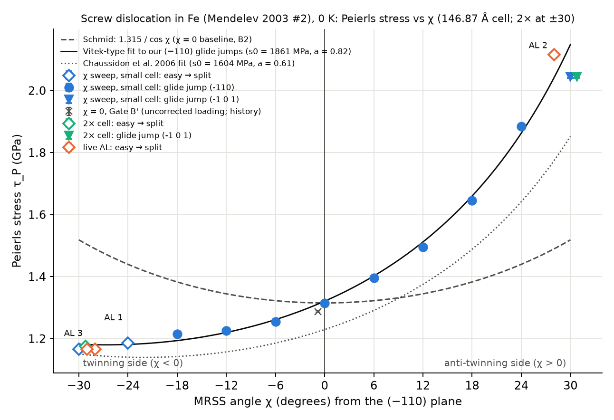
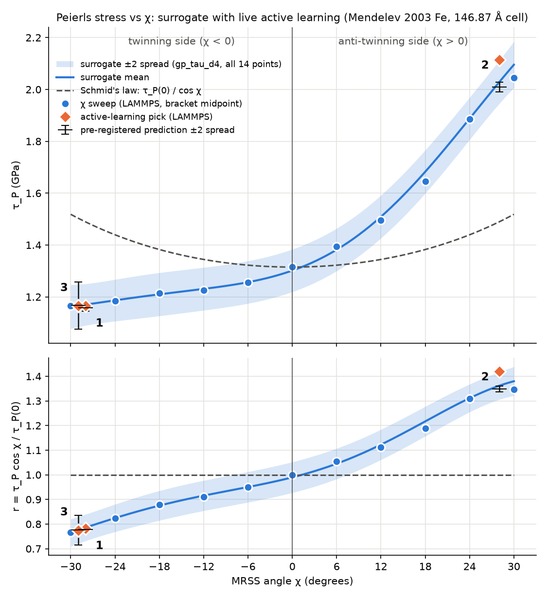

# Project A v0.1

Peierls stress of the ½⟨111⟩ screw dislocation in bcc iron versus the orientation of the applied shear, from LAMMPS
simulations at 0 K, and a small surrogate model with uncertainty that chooses the next simulation, with its prediction
written down before the simulation runs.

## Question
How does the 0 K Peierls stress of the ½⟨111⟩ screw dislocation in bcc iron depend on the orientation of the applied shear
(the MRSS angle χ), and can a small surrogate model with an honest uncertainty choose the next atomistic simulation, with
its prediction written down before the simulation runs?

## Method
- **Atomistic:** LAMMPS (22 Jul 2025 update 6), Mendelev et al. 2003 EAM potential 2 (`potentials/Fe_mm.eam.fs`, fetched by
  `tools/fetch_potential.sh`, see Potential), 0 K
  energy minimisation (CG, force-converged: ftol 10⁻⁶ eV/Å, max step 0.01 Å).
- **Cell:** one straight screw dislocation in a slab, periodic along the line (x = [111]) and the glide direction
  (z = [−1−12], periodic array of dislocations with a b/2 box tilt), free surfaces normal to y = [−110].
  14.84 × 149.4 × 146.87 Å, 27,972 atoms.
- **Loading at angle χ:** σ_xy = τ cos χ by forces on two surface slabs; σ_xz = τ sin χ by box strains calibrated on a
  perfect slab (with a second-order correction), set by rewriting the data file.
- **Peierls stress:** ramp τ from 0 in 50 MPa steps, refine in 10 MPa steps; τ_P is the first stress at which the compact
  easy core at its start site is lost: either a **glide jump** (the core moves at least one lattice step, 2.331 Å, to an
  equivalent compact site) or an **easy → split transition** (the core becomes centred on one atom column). Read from
  differential-displacement (DD) maps. Each "last unmoved" state is checked by a stability test (small random kick,
  re-minimise, must return to the same state).
- **Surrogate** (`src/surrogate/`, PyTorch and scikit-learn): Gaussian process (GP) with its noise level learned between the
  bracket noise (0.0029 GPa) and 0.1 GPa; a 5-member MLP ensemble (bootstrap + randomized priors) and a "Schmid-ratio" form
  were also tested. Calibration check: fraction of left-out values inside ±1 and ±2 predicted spreads.
- **Active learning:** the model picks the angle with the largest predicted spread; its prediction and ±2 band are written,
  time-stamped, to `data/al_live_predictions.csv` before the simulation starts.

## Potential
Mendelev, Han, Srolovitz, Ackland, Sun & Asta, *Phil. Mag.* 83, 3977–3994 (2003), potential #2 for Fe (eam/fs). The file is
not in this repository. `tools/fetch_potential.sh` downloads it from the NIST Interatomic Potentials Repository (entry
2003--Mendelev-M-I-Han-S-Srolovitz-D-J-et-al--Fe-2, version 1) and checks its SHA-256; its tables are identical to the
`Fe_mm.eam.fs` used for every run (only the comment lines differ). `tools/fetch_potential.sh --lammps` fetches that
byte-identical file from the LAMMPS repository instead. NIST's version 3 (2009) of the same entry has different tables
and was not used.

## Quick start (no LAMMPS needed)
```
conda env create -f environment.yml          # pinned versions actually used (pip: requirements.txt)
conda activate projecta-ml
python -m pytest tests                       # 21 tests: 20 pass, 1 skips without per-atom energy files
cd scripts
python fit_vitek.py                          # Vitek-type fit and comparison: data/vitek_fit.json, data/vitek_compare.csv
python plot_peierls_vs_chi.py                # figures/peierls_vs_chi.png   (from data/audit_moves.csv, data/vitek_fit.json)
python plot_surrogate.py                     # figures/surrogate_chi_v1.png (fits the surrogate to data/surrogate_train_v1.csv
                                             #   and data/al_live_results.csv)
```
Other analyses that run from `data/` alone: `scripts/surrogate_loo_d4.py` (leave-one-out), `scripts/al_retro_d4.py`
(retrospective active learning against random choice and bisection).

To re-run simulations: `conda env create -f environment-lammps.yml`, `tools/fetch_potential.sh`, then the run scripts in
`sims/` (each LAMMPS run is started through `tools/launch_safe.sh`). The large per-step data files and run logs are not in
the repository; the per-step results are in `data/*.csv`.

## Validation chain (all computed here; references labelled)
1. Lattice constant 2.85532 Å and cohesive energy −4.12244 eV/atom vs 2.855 Å / −4.122 eV/atom (Mendelev 2003): 0.011 %.
2. C11 / C12 / C44 = 243.33 / 145.01 / 115.99 GPa vs 243.4 / 145.0 / 116.0 GPa (Mendelev 2003, as supplied): ≤ 0.03 %.
3. Potential file identical to NIST "Potential #2" version 1 (30,000 / 30,000 table values).
4. Screw core compact and non-degenerate (three b/3 arrows, symmetry deviations ≤ 0.001 b), as reported for this potential
   by Gilbert et al., PRL 111, 095502 (2013).
5. Cell size: twice the glide length changes τ_P by −0.8 % at χ = 0 and by 0.0 / +0.9 % at χ = +30 / −30 (target < 3 %).
6. Loading on a perfect slab, every angle used: calibrated points σ_xy, σ_xz within 0.1 %, other stresses ≤ 0.08 % of τ;
   interpolated stresses σ_xz within 0.9 % (or a loading tilt ≤ 0.04°), others ≤ 0.24 % of τ.
7. χ = 0: τ_P = 1.310–1.320 GPa vs 1.21 GPa (Chaussidon, Fivel & Rodney, *Acta Mater.* 54, 3407 (2006), same potential):
   **+8.7 %**.
8. pytest: 21 tests (one skips on a fresh clone; it needs per-atom energy files that are not in the repository) (lattice, elastic constants, b, atom counts, tracker, ML code, the "moved" rules, the loading criterion,
   the noise floor, the benchmark formula) pass.

## Verification gates and what they caught
Each item: what looked wrong, and what it was. Full detail, with dates and numbers, in `NOTES.md` ("Things I caught").
- **Reference values that were our own output.** The "published" a₀ and E_coh we first compared against matched our own run
  digit for digit; we switched to the paper's precision.
- **Which potential file.** The file header doesn't say "potential 2"; a table-by-table comparison with NIST settled it, and
  showed that NIST's 2009 revision differs.
- **Frame and cell choices.** A single dislocation periodic along glide needs a box tilt along the line, so the axes were
  relabelled. The periodic cell carries a built-in non-glide shear (about ±0.7 GPa); a cell twice as long tested it.
- **Hard core relaxes away.** A core started at the hard site slid to the easy site, so the easy core was found by trying
  both.
- **Memory.** The first builder needed > 10 GB for the large cell and crashed the laptop; it now builds plane by plane.
- **CPU count.** `nproc` reports 1 once OMP_NUM_THREADS = 1; and using all 8 cores was 6× slower than 7.
- **Energy rise misread.** A +0.84 eV step was the normal elastic rise per 10 MPa, not a new core.
- **The Burgers triangle is not the core shape.** The triangle holding b can sit beside the core; the column with the
  largest DD sum shows where the core is.
- **Lattice units.** LAMMPS's oriented lattice gave ⅔ of the true z repeat; caught by a zero-strain stress check.
- **A box tilt is not a pure shear.** In the [111] frame an xz tilt also creates normal stresses of 44 %; hence the
  calibrated multi-strain loading.
- **Second-order stresses.** The surface-force loading leaves ~3 % non-glide stress at τ_P; corrected for χ ≠ 0 and, from
  Session 13, for χ = 0 too.
- **A tracker that depends on its window.** The energy-centroid core position moved by up to 0.8 Å with window size; DD maps
  are used instead.
- **A bug that looked like physics.** A χ = 0 rerun gave 1.25 instead of 1.28 GPa. The first explanation ("minimiser path
  dependence") was wrong: LAMMPS's `change_box … remap` stretched the slab by 10⁻⁴ on every call. Fixed by rewriting the
  box ourselves; the result then agreed on 7 and 8 processes.
- **Refinement steps** added +10, +20, +30 MPa instead of +10 each time.
- **A jump the tracker missed** (1.98 Å read for a 2.331 Å move), so "moved" is now read from DD maps.
- **Garbage per-atom energies** for atoms on the cell boundary right after minimisation; fixed by re-evaluating first.
- **The ML ensemble was over-confident** (7 % inside ±1 spread); bootstrap + random priors fixed it on test data.
- **Live-AL recorder** took the coarse "moved" step instead of the fine one; the bad record was kept and the round it
  affected was voided.
- **A failed check did not stop a script** (`set -e` without `pipefail`).
- **A relative tolerance on a near-zero target.** "σ_xz within 1 %" failed at χ = 3° for a 0.037° tilt; the criterion now
  also accepts a loading-angle error ≤ 0.1° (changed after the failure, recorded as such).
- **The reference was a restatement.** ~1.25 GPa came from a later paper; the original gives 1.21 GPa.
- **A rule that depended on a label.** At χ = +28 the "moved" test first fired on a core change in place, then on a pure
  relabelling (atoms moved ≤ 0.013 Å). The current rule is label-free (easy → split or glide jump).
- **A stability test that ignored the loading model at χ = 0.**
- **A kink that was a protocol difference.** χ = 0 sat 0.03 GPa below its neighbours because it ran without the loading
  correction the other angles had; rerun with it, the point lies on the curve.

## Results
**χ curve** (146.87 Å cell; `data/surrogate_train_v1.csv`, `data/audit_moves.csv`, `figures/peierls_vs_chi.png`):

| χ (°) | side | τ_P bracket (GPa) | event | plane of a glide jump |
|---|---|---|---|---|
| −30 | twinning | 1.160–1.170 | easy → split | — |
| −29 | twinning | 1.160–1.170 | easy → split | — |
| −28 | twinning | 1.160–1.170 | easy → split | — |
| −24 | twinning | 1.180–1.190 | easy → split | — |
| −18 | twinning | 1.210–1.220 | glide jump | (−110) |
| −12 | twinning | 1.220–1.230 | glide jump | (−110) |
| −6 | twinning | 1.250–1.260 | glide jump | (−110) |
| 0 | — | 1.310–1.320 | glide jump | (−110) |
| +6 | anti-twinning | 1.390–1.400 | glide jump | (−110) |
| +12 | anti-twinning | 1.490–1.500 | glide jump | (−110) |
| +18 | anti-twinning | 1.640–1.650 | glide jump | (−110) |
| +24 | anti-twinning | 1.880–1.890 | glide jump | (−110) |
| +28 | anti-twinning | 2.110–2.120 | easy → split | — |
| +30 | anti-twinning | 2.040–2.050 | glide jump | (−1 0 1) |

- Twinning side easier, anti-twinning side harder: the ratio to Schmid's law (1.315 / cos χ) runs from 0.77 at −30° to
  1.35 at +30°.
- **The twinning-side points −24, −28, −30 (and +28) are easy → split transitions.** The split core is a known artifact of
  the Mendelev potential (Gilbert et al., PRL 111, 095502 (2013)), so these points characterise the potential, not iron.
- **Benchmark against Chaussidon et al. 2006 (same potential):** fitting τ(χ) = s0 / (cos χ + a cos(60° + χ)) to our
  (−110) glide jumps gives s0 = 1861 ± 18 MPa, **a = 0.82 ± 0.03**, against their s0 = 1604 MPa, **a = 0.61** (values as
  read by the planning chat). Same direction and shape; our asymmetry is stronger, and our values are 1–15 % above their
  fit. Why is open (Limitations).



**Surrogate, leave-one-out** (GP with learned noise, `data/surrogate_loo_d4_s14_summary.json`):
- all 14 points: RMSE 0.072 GPa, fraction inside ±1 / ±2 spreads 0.71 / 0.79 (ideal 0.68 / 0.95), learned noise 0.036 GPa.
  The large errors are all at +24, +28, +30, where an easy → split value (+28, 2.115 GPa) sits above two glide jumps
  (+24, +30); elsewhere the errors are ≤ 0.024 GPa.
- the 8 (−110) glide jumps only: RMSE 0.034 GPa, inside ±2: 0.88, learned noise at its floor (0.0029 GPa): the glide-jump
  curve is smooth once χ = 0 uses the same loading recipe as the other angles.



**Live active learning, pre-registered** (`data/al_live_predictions.csv`, `data/al_live_results.csv`):

| Round | χ | model | predicted (±1 spread) | ±2 band | measured | z | inside ±2? | event |
|---|---|---|---|---|---|---|---|---|
| 1 | −28° | GP, Schmid-ratio form, fixed noise | 1.158 ± 0.007 | 1.145–1.171 | 1.160–1.170 | +1.0 | yes | easy → split |
| 2 | +28° | same | 2.009 ± 0.009 | 1.990–2.027 | 2.110–2.120 | +11.3 | **no** | easy → split |
| 3 | −29° | GP, learned noise | 1.167 ± 0.045 | 1.076–1.257 | 1.160–1.170 | −0.04 | yes | easy → split |

- Round 2 missed because the model had never seen a split transition on the anti-twinning side: the +28 value lies
  0.07 GPa above the smooth curve through +24 and +30 (and above +30 itself), and the model's noise was fixed at the
  bracket noise, so its band was only ±0.02 GPa. After that, the noise level was made learnable.
- A third round picked in Session 12 was voided (picked from wrongly recorded data); its row stays in the file.
- Round 3 was a hit, but a weak test: after round 2 the learned noise rose to 0.038 GPa, so the band was ±0.09 GPa wide,
  and the pick lay between two measured neighbours (−30 and −28) with the same value.
- Largest predicted spread over the remaining candidate angles (same model): 0.022 GPa before any live round, 0.005 after
  round 1, 0.045 after round 2 (the +28 surprise), 0.043 after round 3 (−5 %). The loop did not make the model surer
  overall; the +28 point showed it a kind of event it cannot represent as a smooth curve.

**The honest active-learning finding:** on this one-dimensional curve, a fixed "measure the ends first, then bisect the
largest gap" rule matches or beats the spread rule: it is better at 5–6 points, and the spread rule is ahead at 8–9 points
by about 0.001–0.002 GPa, less than the learned noise. v0.1 shows a closed, pre-registered loop, not a saving in
simulations. v0.2, with two inputs (χ and a second stress component), is the real test.

## Pre-registered v0.2 test (written 28 Oct 2026, before any v0.2 data)
- **Inputs:** the MRSS angle χ in [−30°, +30°] and a second, non-glide stress σ_yz. The σ_yz range is set only after its
  own loading gate (a perfect-slab calibration like Gate A) passes.
- **Ground truth:** a dense grid of LAMMPS runs over (χ, σ_yz), held out from every method.
- **Metric:** the number of LAMMPS runs a method needs to reach RMSE ≤ 0.02 GPa on the held-out grid.
- **Contenders:** spread-based active learning, random choice, a regular grid, and a space-filling design; 20 seeds for each
  method with randomness.
- **Claim rule:** a saving is claimed only if active learning needs fewer runs than the best other method in at least 15 of
  20 seeds. Otherwise this README will report that active learning did not help.
- **Model:** the surrogate will know the event type (glide jump vs easy → split), since one smooth model cannot fit both.

## Limitations
- The twinning-side values are easy → split transitions, a known artifact of this potential.
- Small cell (146.87 Å along glide). The cell-size test with the corrected χ = 0 loading is deferred to v0.2.
- Our asymmetry (a = 0.82) is stronger than Chaussidon's (0.61), unexplained. Candidate causes: our cell is periodic along
  the glide direction where theirs has free boundaries; the built-in non-glide shear of our periodic cell (but doubling the
  cell changed ±30 by only 0.0 / +0.9 %); and we compare our fit with their fit, not with their raw data.
- One smooth model for two kinds of event: across all points the learned noise is 0.036 GPa (12× the bracket noise) and
  LOO ±2 coverage is 0.79 (ideal 0.95). On the glide jumps alone the curve is smooth (noise at the floor, coverage 0.88).
  A model that knows which event to expect is not built.
- One interatomic potential, 0 K, a straight dislocation (no temperature, no kink pairs).

## How it was built
AI tools (Claude Code) wrote the code and ran the simulations. Anshuman Choudhury designed the verification gates, the tests
and every physics choice (potential, cell, loading, the "moved" definition, tolerances), and checked the key numbers.
Every result traces to a file in this repository: the per-step results in `data/`, the validation logs in `checks/`, and
the session-by-session record of what was run, why and what came out in `NOTES.md` (prompts in `PROMPTS.md`).

## Licence
MIT (`LICENSE`). The potential file is not covered: cite Mendelev et al. (2003) and the NIST repository.
